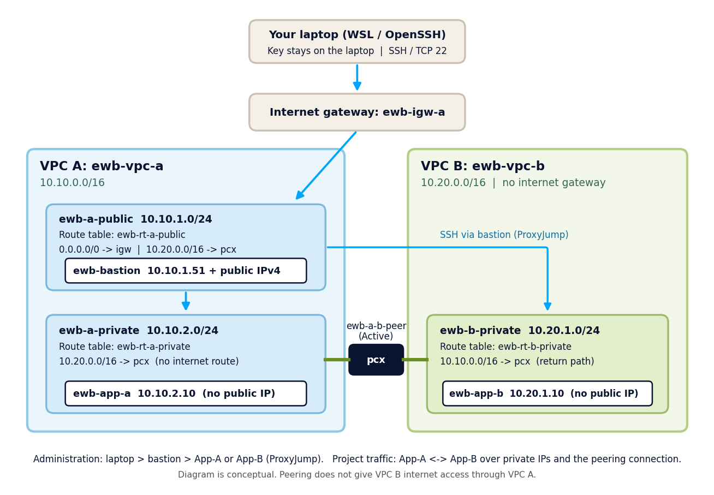

# AWS VPC Peering Project (EWB Courses, Project 01)

Two VPCs connected with a VPC peering connection, with a public bastion host in VPC A and two private application servers. Built and tested in **ap-southeast-2 (Sydney)**.

**Author:** Mohamed Afsar  |  **Batch:** AWS CLOUD INTERNSHIP  |  **Completed:** 30 October 2026



## Address plan

| Resource | Location | CIDR / address |
|---|---|---|
| ewb-vpc-a | VPC A | 10.10.0.0/16 |
| ewb-a-public | VPC A, public subnet | 10.10.1.0/24 |
| ewb-a-private | VPC A, private subnet | 10.10.2.0/24 |
| ewb-vpc-b | VPC B (no internet gateway) | 10.20.0.0/16 |
| ewb-b-private | VPC B, private subnet | 10.20.1.0/24 |
| ewb-bastion | ewb-a-public | 10.10.1.51 + public IPv4 |
| ewb-app-a | ewb-a-private | 10.10.2.10 (no public IP) |
| ewb-app-b | ewb-b-private | 10.20.1.10 (no public IP) |

## What was built

- 2 VPCs with non-overlapping CIDRs, 3 subnets with explicit route table associations
- 1 internet gateway (`ewb-igw-a`), attached to VPC A only
- 3 route tables: `ewb-rt-a-public`, `ewb-rt-a-private`, `ewb-rt-b-private`
- 3 security groups (`ewb-sg-bastion`, `ewb-sg-app-a`, `ewb-sg-app-b`) scoped to single lab hosts
- 3 EC2 instances (Amazon Linux 2023, t3.micro)
- 1 peering connection (`ewb-a-b-peer`) with forward and return routes

## Routes

| Route table | Subnet | Routes |
|---|---|---|
| ewb-rt-a-public | ewb-a-public | 10.10.0.0/16 local, 0.0.0.0/0 to igw, 10.20.0.0/16 to pcx |
| ewb-rt-a-private | ewb-a-private | 10.10.0.0/16 local, 10.20.0.0/16 to pcx |
| ewb-rt-b-private | ewb-b-private | 10.20.0.0/16 local, 10.10.0.0/16 to pcx |

## Security group rules (inbound)

| Group | Rule | Source |
|---|---|---|
| ewb-sg-bastion | SSH 22 | my public IP /32 |
| ewb-sg-app-a | SSH 22 | 10.10.1.51/32 (bastion) |
| ewb-sg-app-a | ICMP Echo Request | 10.20.1.10/32 (App-B) |
| ewb-sg-app-b | SSH 22 | 10.10.1.51/32 (bastion) |
| ewb-sg-app-b | ICMP Echo Request | 10.10.2.10/32 (App-A) |

## Test results

| Test | Result |
|---|---|
| 01 Baseline: App-A pings App-B before the private routes exist | 100% packet loss |
| 02 Forward path: App-A to App-B | 4/4 replies, 0% loss |
| 03 Reverse path: App-B to App-A | 4/4 replies, 0% loss |
| 04 Private SSH: `ssh ewb-app-b` through the bastion (ProxyJump) | Connected |
| 05 Isolation: App-A and App-B have no public IPv4 | Confirmed |
| Controlled failure: ICMP rule removed, then restored | 100% loss, then 0% loss |

Screenshots are in [`screenshots/`](screenshots/) (account ID and public IPs are blurred). The full write-up is in [`report/`](report/).

## Key concepts

- **Return route:** the reply must also find its way back, so both VPCs need a route to the other through the peering connection.
- **Active peering is not enough:** routes on both sides and matching security group rules are also required.
- **ProxyJump:** the bastion opens its own connection to App-B, so App-B sees the bastion's private IP as the SSH source.
- **Peering is non-transitive:** VPC B cannot use VPC A's internet gateway.

## Cleanup

All resources were deleted after testing (instances, peering routes and connection, security groups, subnets, route tables, internet gateway, VPCs, key pair). See screenshots 26 to 29.

## Security notes

No private keys, credentials or account IDs are committed. See `.gitignore` and `templates/ssh-config.example`.

## Repository structure

```
aws-vpc-peering-project/
  README.md
  .gitignore
  docs/          architecture diagram and test commands
  report/        final report (PDF and Word)
  screenshots/   numbered evidence screenshots (blurred)
  templates/     SSH config example (no keys)
```
